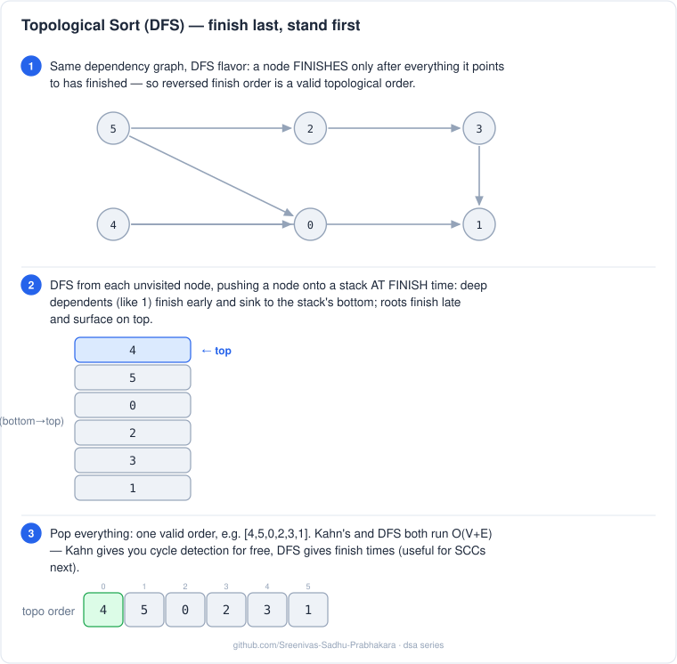

# Topological Sort (DFS)

> Striver SDE Sheet 160 · Day 23 Graph — a vertex finishes only after everything it can reach; reversed finish order is therefore topological. Go, stdlib only, tested.

## Problem

Topological ordering again, by DFS — the sheet pairs it with Kahn (#159) because the two derive the same answer from opposite ends.

## Approach

In a DFS of a DAG, a vertex is *finished* (appended post-recursion) only after all of its out-neighbors finished — so finish order is reverse-topological, and reversing it yields the answer. That's the entire algorithm: DFS everything, record on exit, flip. Cycle safety comes from the same three-color scheme as #157, since finish-order logic silently produces garbage on cyclic input — the `ok` flag turns that garbage into an honest failure. DFS-topo is also the first half of Kosaraju's SCC algorithm (#164), which is why it earns a separate repo from Kahn.

**Complexity:** O(V+E) time, O(V) recursion.

## Visual walkthrough

Read the picture top to bottom — each numbered frame is one moment of the algorithm
running on this repo's test example.

## Run

    go test ./...   # verify
    go run .        # demo

---

One of 191 repos solving Striver's SDE Sheet in Go — stdlib only, one problem per repo, every solution tested. Browse the set: [`dsa-*` repos](https://github.com/Sreenivas-Sadhu-Prabhakara?tab=repositories&q=dsa-&type=source).
